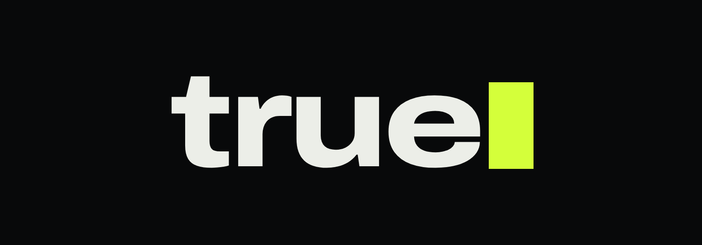

  

<h3 align="center">a massive roleplay experience</h3>

  Ein eigenständiges Roleplay-Spiel. Eine Welt. Tausende Leben gleichzeitig.

---

## Was ist true?

**true** ist ein Roleplay-Spiel, das von Grund auf für Roleplay gebaut wird. Es ist keine Mod und kein Server auf einem fremden Spiel. Du spielst einen Charakter in einer persistenten Welt der **nahen Zukunft**: eine Stadt im Wandel, in der Alt und Neu aufeinandertreffen und in der jeder Spieler Teil derselben Geschichte ist.

Bis zu **4000 Spieler teilen sich eine einzige Welt.** Es gibt keine Kopien und keine getrennten Server-Instanzen, auf denen deine Freunde gerade nicht sind. Wer dir auf der Straße begegnet, ist wirklich da, und du siehst und hörst ihn.

## Erst die Stadt, dann die Welt

true startet mit **einer Stadt**. Von dort aus wächst die Welt mit jedem Update: Umland, Küste, Wildnis. Neue Gebiete schließen nahtlos an, ohne Ladebildschirm an der Stadtgrenze.

## Wer willst du sein?

Polizistin, Sanitäter, Mechanikerin, Taxifahrer, Anwältin, Unternehmer, Beamter oder jemand, der lieber im Schatten arbeitet. In true entstehen Berufe, Fraktionen und Geschichten durch die Spieler selbst. Die Welt lebt auch ohne dich: Verkehr, Passanten und Tiere bewegen sich durch die Stadt, und Live-Events können jederzeit alles verändern.

## Die Einreise

Jeder neue Charakter beginnt bei der **Einreisebehörde**. Die Whitelist ist kein Formular auf einer Website. Du sprichst mit echten Spielern, die als Beamte über deine Einreise entscheiden. Dein Roleplay beginnt damit in der ersten Minute.

## Fair by design

- **Kein Pay-to-Win.** Gekauft wird nur Aussehen: Kleidung, Frisuren, Lackierungen, Emotes. Geld, Werte und Vorteile gibt es nur im Spiel.
- **Keine Lootboxen.** Du siehst, was du kaufst, und zahlst einen festen Preis.
- **Kämpfe gehören dazu, sind aber nicht der Kern.** Konflikte sollen sich fair anfühlen, und der Server entscheidet, nicht der schnellste Cheat.

## Stand

true befindet sich **in früher Entwicklung**. Grafik, Inhalte und Systeme entstehen gerade, Termine gibt es noch keine. Unsere Repositories sind privat.

true▮ – a massive roleplay experience

